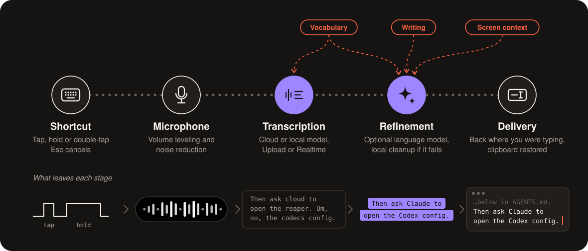
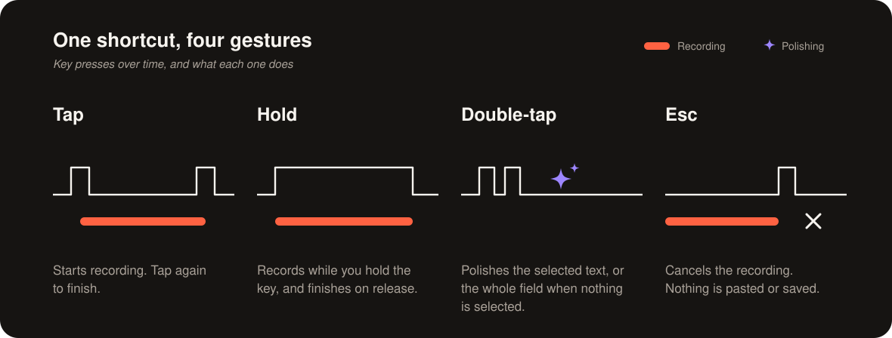
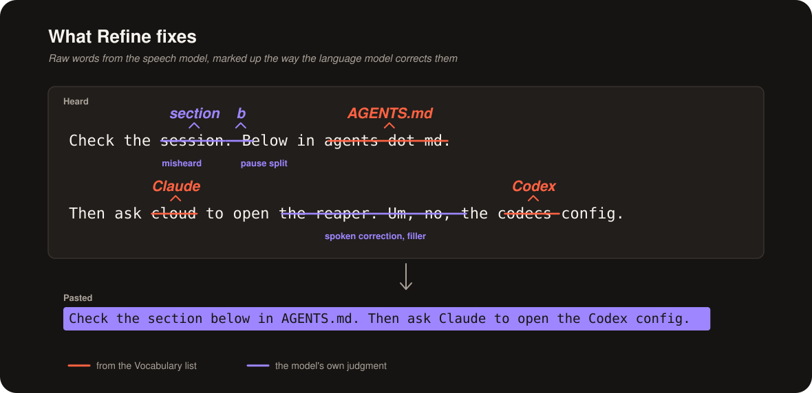

# Vhrase

<h3 align="center">Pay for the API, not the app.</h3>

Vhrase lives in the menu bar: press a shortcut in any app, speak, and the cloud provider you hold a key for transcribes it, an LLM polishes it if you want, and the text lands where you were typing.

This is a personal project shared for reference, not a product: clone it and have your coding agent reshape it to how you work.



## How It Works

The shortcut is ⌃⌥Space by default, or Fn/Globe or one you record, and each press does something different.



Polishing chooses whether each dictation gets an LLM pass before delivery: Refine cleans it up with your Writing style, and Restyle rewrites it with a preset or your own instruction. Double-tap always restyles, and you can try a style on your five latest dictations first. Screen context is optional, and local cleanup runs if the request fails.



The text is pasted into the app you started in, your clipboard is restored, and History keeps a searchable local copy unless you turn it off.

## Speech Models

| Provider | Runs | Realtime | Vocabulary hints | Notes |
| --- | --- | --- | --- | --- |
| ElevenLabs | Cloud | Yes | Yes | Vocabulary costs 20% more |
| Gemini | Cloud | — | Yes | Smart transcription formats text |
| OpenAI | Cloud | — | Yes | Language hint |
| Vercel | Cloud | — | — | Any AI Gateway model, Grok by default |
| xAI (Grok) | Cloud | Yes | Yes | Filler removal, number formatting |
| Hugging Face | Local | — | — | Whisper Large v3 Turbo; other models untested |
| Parakeet | Local | — | — | 25 European languages |

Local models need no key and run offline after a one-time download, but they are only a baseline: Polishing has no local model yet.

## What It Costs


Regular use is about 8 minutes of speech in 100 dictations a day, from a published 90-day log, at xAI's \$0.10 per hour of audio plus about \$0.0005 per GPT-6 Luna polish with a screenshot.
App prices are October 2026 list prices; only the yearly totals are estimates.

## What Leaves Your Mac

- Cloud transcription sends the recording to the selected provider.
- Polishing sends the text and the target app's name to your endpoint, plus a screenshot only when screen context is on, which it is not by default.
- With a local model and After transcription set to Off, as it is by default, dictation never leaves the Mac.
- API keys stay in the macOS Keychain, and History, settings, and logs stay local; logs never include audio, transcripts, or keys.

## Install

On an Apple silicon Mac with macOS 14 or later, download the latest `Vhrase-x.y.z.zip` from [Releases](https://github.com/teron131/Vhrase/releases), unzip it, and move Vhrase to Applications.
It isn't notarized, so macOS blocks the first launch: open **System Settings → Privacy & Security** and choose **Open Anyway**.

Or build it yourself, with macOS 14 and Swift 6.2 or later:

```sh
bash scripts/ensure-local-codesign-identity.sh   # once per Mac, so rebuilds keep their permissions
./scripts/build-and-run.sh                       # build, sign, and launch dist/Vhrase.app
```

Then open **System** from the sidebar's gear, which walks you through the rest:

1. Add a key for each cloud provider you use, or download a local model in **Transcription**.
2. Allow Microphone, and Accessibility so Vhrase can paste into other apps.
3. Speak a short phrase in **Transcription → Test**.
4. To polish dictation, add an LLM key, enter a model in **Polishing**, and set After transcription to Refine or Restyle.

Keys can also come from environment variables such as `XAI_API_KEY`, or from an ignored `.env` file for development builds.
